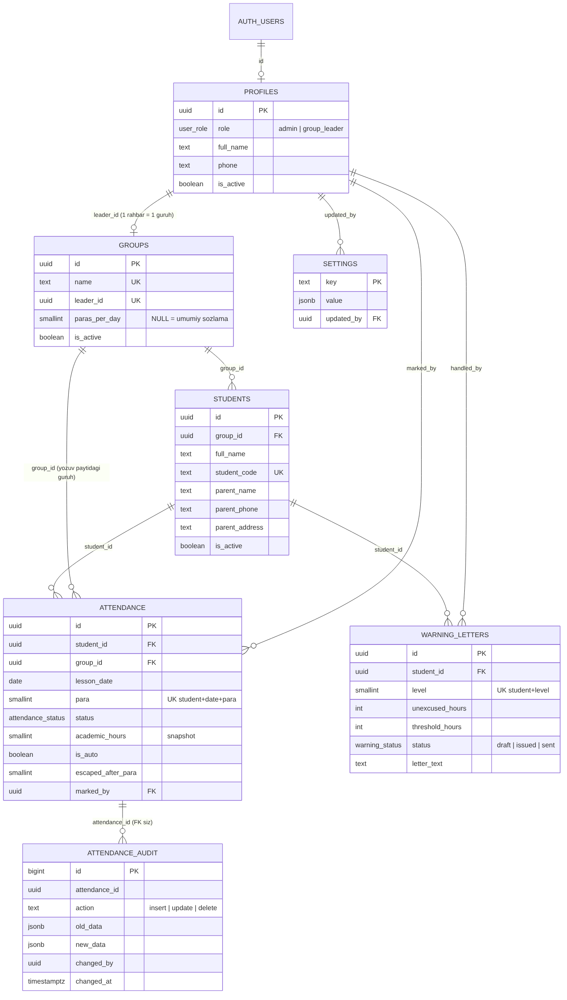

# Ma‘lumotlar bazasi sxemasi

Mermaid manbasi: [`er-diagram.mmd`](er-diagram.mmd). Migratsiyalar: `supabase/migrations/`.

## Jadvallar

| Jadval | Vazifasi | Yozish yo‘li |
|---|---|---|
| `profiles` | `auth.users` ga bog‘langan profil: rol, ism, faollik | admin/rahbar yaratish — faqat Edge Function; `full_name/phone/is_active`ni admin yangilaydi |
| `groups` | Guruhlar; `leader_id` (UNIQUE) — bir rahbar bitta guruh; `paras_per_day` — guruh uchun alohida kunlik para soni (NULL = umumiy) | admin (to‘g‘ridan-to‘g‘ri, RLS) |
| `students` | O‘quvchilar + ota-ona ma‘lumotlari (xat uchun) | admin (RLS) |
| `attendance` | Davomat: o‘quvchi + sana + para, **UNIQUE** | faqat `mark_attendance` / `mark_attendance_bulk` |
| `attendance_audit` | Davomatdagi har bir insert/update/delete tarixi (trigger) | faqat trigger |
| `warning_letters` | 72 soatdan oshganda avtomatik yaratiladigan ogohlantirishlar | yaratish — `recompute_warnings` (ichki, `mark_attendance` chaqiradi); tahrir — `update_warning` |
| `settings` | Sozlamalar (kalit → JSON qiymat) | faqat `update_setting` (admin) |

## Sozlamalar (`settings`)

| Kalit | Standart | Ma‘nosi |
|---|---|---|
| `academic_hours_per_para` | `2` | Bir para necha akademik soat (1..6) |
| `paras_per_day` | `4` | Kunlik rejalashtirilgan paralar (1..8); `groups.paras_per_day` ustun turadi |
| `warning_threshold_hours` | `72` | Ogohlantirish chegarasi (1..1000) |
| `college_name` | `"4-son Texnikum"` | Xat matnida |
| `timezone` | `"Asia/Tashkent"` | "Bugun" va "kelajak sana" tekshiruvi uchun |

## Davomat qoidalari (bazada qanday amalga oshirilgan)

1. **Holatlar:** `present`, `excused_absent`, `unexcused_absent`, `escaped`.
2. **Takrorlanmaslik:** `UNIQUE (student_id, lesson_date, para)`. Qayta belgilash yangi qator emas, mavjudini yangilaydi (UPSERT).
3. **Akademik soat:** yozuv yaratilganda `academic_hours` ga sozlamadagi qiymat **nusxa (snapshot)** qilinadi. Keyin sozlama o‘zgarsa, eski yozuvlar qayta hisoblanmaydi; yangilari yangi qiymatni oladi.
4. **72 soat:** faqat `unexcused_absent` yozuvlarining `academic_hours` yig‘indisi. `yig‘indi > chegara` bo‘lgandagina ogohlantirish. Aynan 72 soat — ogohlantirish **yo‘q**.
5. **Ogohlantirish darajasi:** `level = ceil(soat / chegara) − 1` → 73..144 soat = 1-daraja, 145..216 = 2-daraja va h.k. Har daraja uchun bitta xat (`UNIQUE (student_id, level)`). Soat tuzatish bilan kamayib, daraja tushib ketsa, **qoralama** xatlar o‘chiriladi; `issued/sent` xatlar saqlanadi.
6. **"Darsdan qochdi" (`escaped`):** `K`-para (1, 2 yoki 3) qatoriga `escaped` yoziladi (shu para tugagach ketgan). `K+1 … kunlik_paralar` oralig‘idagi paralar `unexcused_absent` + `is_auto = true` bo‘lib avtomatik yoziladi (mavjud qo‘lda belgilar ham shunday yoziladi). `K` dan **oldingi** paralarga tegilmaydi. `escaped` qatorining o‘zi 72 soatga kirmaydi. Bir o‘quvchi bir kunda faqat bitta `escaped`ga ega (qisman UNIQUE indeks).
   * `escaped` boshqa holatga o‘zgartirilsa yoki boshqa para uchun qayta belgilansa: avtomatik yozuvlar o‘chiriladi, eski `escaped` qatori `present` bo‘ladi, so‘ng yangisi qo‘llanadi.
   * Avtomatik yozuvni qo‘lda o‘zgartirsangiz u oddiy yozuvga aylanadi (`is_auto = false`).
   * Qochgan paradan keyin rejalashtirilgan para bo‘lmasa (masalan kunlik 3 para, 3-paradan keyin) xato qaytariladi.

## Ko‘rinishlar (views, `security_invoker` — RLS saqlanadi)

* `v_student_absence_summary` — o‘quvchi bo‘yicha `unexcused_hours`, `excused_hours`, `escaped_count`, `present_paras`, `threshold_hours`, `threshold_exceeded`.
* `v_group_attendance_daily` — guruh/sana/para bo‘yicha holatlar soni.

## Xavfsizlik modeli

* Barcha 7 jadvalda RLS yoqilgan; `anon` roliga hech narsa berilmagan.
* **Administrator:** hamma narsani ko‘radi; guruh/o‘quvchi/sozlama/ogohlantirishni boshqaradi.
* **Guruh rahbari:** faqat o‘z guruhini va uning o‘quvchilari davomati/ogohlantirishlarini **o‘qiydi**; davomatni faqat RPC orqali, faqat o‘z guruhi uchun yozadi. Vakolat serverda (`mark_attendance` ichida) tekshiriladi, shuning uchun frontendni aldab bo‘lmaydi.
* Profili yo‘q yoki `is_active = false` foydalanuvchi hech narsa ko‘rmaydi (barcha siyosatlar profilga tayanadi). Rahbar faolsizlantirilganda Auth'da ham bloklanadi (`ban_duration`).
* **Bitta administrator:** `profiles_single_admin` UNIQUE indeksi + `profiles_guard` trigger (admin qo‘shish faqat `bootstrap_admin()` ichida, rolni o‘zgartirish va adminni o‘chirish/faolsizlantirish taqiqlangan) + `bootstrap_admin()` ga faqat `service_role` ega.
* `profiles` da `role/id` ustunlarini yangilash huquqi hech kimda yo‘q (ustun darajasidagi GRANT).
* Parollar faqat Supabase Auth ichida (bcrypt) saqlanadi; bu loyiha parolni hech qayerda saqlamaydi/yozmaydi.
* Rahbar o‘quvchisini boshqa guruhga ko‘chirsa: eski davomat yozuvlari eski `group_id` bilan qoladi, lekin yangi rahbar o‘z o‘quvchisining butun tarixini ko‘radi (RLS `student_id` bo‘yicha).
